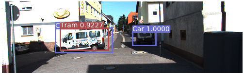
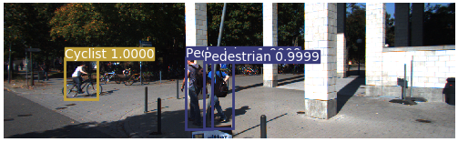

# YoloV3-Disnet

Object detection with **YOLOv3** (PyTorch) plus monocular **distance estimation** with **DisNet**
(Haseeb et al., 2018). YOLOv3 finds objects (trained here on **KITTI**), and DisNet turns each bounding box into an
estimated distance in metres, from a single camera.

| | |
|---|---|
|  |  |

## Repository layout

```
detect.py                 run the detector on a folder of images, save annotated copies
train.py                  train / fine-tune on a dataset described by config/*.data
test.py                   per-class AP and mAP on the validation list
video.py                  webcam / video demo: YOLOv3 boxes + DisNet distances
train_disnet.py           train a DisNet distance model on KITTI labels or your own annotations
train_disnet_rnn.py       train the temporal (GRU) DisNet on KITTI tracking labels, compare it with the feed-forward one
models.py                 Darknet / YOLOv3 model, cfg parser, weight loading & saving
utils/
  datasets.py             image-folder and list-file datasets (letterbox padding, label loading)
  evaluation.py           mAP evaluation shared by train.py and test.py
  disnet.py               DisNet: box -> 6 features -> distance (pure NumPy, no TensorFlow needed)
  temporal.py, tracker.py temporal DisNet: IoU tracker + GRU distance model + GRU next-box model (PyTorch)
  utils.py                NMS, IoU, target building, AP, optional visdom wrapper
config/                   yolov3, yolov3-tiny, yolov3-kitti cfgs + kitti.data / coco.data
data/                     class names, a 16+16 image KITTI sample, sample images for detect.py
label_transform/          KITTI -> YOLO label converter
tests/                    DisNet regression tests + 1,795 real labelled boxes (class, box size, measured distance)
generated_files/          disnet_model_3.npz = the authors' pretrained DisNet (used by video.py by default);
                          model@*.json/.h5 are the old 4-input experiments, no longer used
```

## Setup

```bash
python -m venv .venv && source .venv/bin/activate
pip install -r requirements.txt            # detect / train / test
pip install -r requirements-extras.txt     # only for video.py (opencv), importing Keras models (h5py) and --visdom
```

## Quick start

All commands run from the repository root and fall back to CPU when CUDA is unavailable
(`--use_cuda false` forces CPU).

**Detect** (needs a trained KITTI weights file, see below):

```bash
python detect.py --image_folder data/samples --weights_path weights/kitti.weights
# annotated images go to output/
```

**Train.** The repository ships a tiny KITTI sample (`data/kitti/`, 16 train / 16 val images) so you can check
that everything works end to end:

```bash
# from random init (smoke test)
python train.py --epochs 1 --batch_size 4 --weights_path none

# real training: start from the darknet53 backbone weights
wget https://pjreddie.com/media/files/darknet53.conv.74 -P checkpoints
python train.py --epochs 100 --batch_size 10 --weights_path checkpoints/darknet53.conv.74
```

Checkpoints are written to `checkpoints/` every `--checkpoint_interval` epochs, and the best validation mAP is
kept as `checkpoints/kitti_best.weights`. The backbone is frozen for the first `--freeze_epochs` epochs (default
20; `0` disables). Add `--visdom` for live loss plots (start `python -m visdom.server` first).

**Evaluate:**

```bash
python test.py --weights_path checkpoints/kitti_best.weights
```

**Video / webcam with distances:**

```bash
wget https://pjreddie.com/media/files/yolov3.weights -P weights   # COCO weights (default for video.py)
python video.py                       # default webcam, press q to quit
python video.py --source clip.mp4
```

## Using your own KITTI data

`train.py` expects YOLO-format labels (`class cx cy w h`, normalised) in a `labels/` directory that mirrors an
`images/` directory, and a text file listing one image path per line (paths relative to where you run the script
work fine). Convert raw KITTI labels with:

```bash
python label_transform/kitti2coco-label-trans.py \
    --images data/kitti/images/train --labels /path/to/kitti/label_2 \
    --out data/kitti/labels/train --names data/kitti.names --list data/kitti/train.txt
```

Then point `config/kitti.data` at your list files. `DontCare` boxes and classes missing from `--names` are skipped.

## DisNet distance estimation

`video.py` follows the DisNet paper. For every detected box it computes six features

```
v = [1/Bw, 1/Bh, 1/Bd, Ch, Cw, Cb]
```

where `Bw`, `Bh` are the box width / height relative to the image width / height, `Bd = sqrt(Bw^2 + Bh^2)`, and
`Ch, Cw, Cb` are the typical real-world height / width / breadth (cm) of the detected class. A small fully
connected network (here 6 -> 100 -> 100 -> 1, SELU) maps `v` to the distance in metres. **No input scaling is applied**;
the features go into the network as they are. The code is in `utils/disnet.py` and is pure NumPy.

- **Supported classes:** person, car, truck, bus, bicycle, motorbike, cat, dog, horse, sheep, cow (the classes the
  authors defined sizes for; KITTI's `Pedestrian` and `Cyclist` are mapped to `person` / `bicycle`). Other detections
  are drawn without a distance. Edit `CLASS_SIZES_CM` in `utils/disnet.py` to add classes.
- **Pretrained model:** `generated_files/disnet_model_3.npz` is the authors' model from
  [guanjianyu/DisNet](https://github.com/guanjianyu/DisNet) (MIT licence, see `generated_files/DisNet-LICENSE.txt`),
  converted from Keras to NumPy arrays; the NumPy forward pass matches Keras to float precision.
- **Feature order:** equation (1) of the paper lists `1/Bh` before `1/Bw`, but the authors' released training and
  inference code, and therefore their pretrained model, use `1/Bw` first. This project follows the code.
  Likewise `Bd` is taken from the normalised width / height as in the code.

**Verified behaviour.** `python -m unittest discover -s tests -v` runs the checks. Among them: the NumPy forward pass
matches an independent PyTorch implementation, and on 1,795 real labelled boxes (person / car / bicycle, measured with a
laser scanner, from the authors' data-preparation notebook) the pretrained model reaches a mean absolute error of
2.5 m (median 1.2 m, correlation 0.95, 73 % of estimates within 10 %). The same test shows that swapping the width/height
order or normalising the diagonal by the image diagonal more than doubles the error (MAE about 5.5 m instead of 2.5 m),
which is why the code follows the authors' feature definition. `truck`, `bus` and the animal classes use the authors' size table, but the published
labelled data contains no examples of them, so those distances are extrapolations.

**Accuracy depends on the camera.** The features are relative to the image size but not to the focal length, so
a model is most accurate on cameras similar to the one it was trained on. The authors' model was trained on a
2592x1944 camera. On the 74 well-visible (not heavily truncated or occluded) cars, pedestrians, cyclists and trucks in
the 32 bundled KITTI sample images (ground truth from the KITTI 3D labels) it correlates well with the true distance
(r = 0.80) but is off by about 20-25 % (median relative error; MAE about 8 m), which is expected for a different camera. For a KITTI-like setup, train DisNet on KITTI itself:

```bash
python train_disnet.py --kitti_labels /path/to/training/label_2 --kitti_images /path/to/training/image_2 \
                       --out generated_files/disnet_kitti.npz
python video.py --disnet_model generated_files/disnet_kitti.npz --weights <kitti yolo weights> --cfg config/yolov3-kitti.cfg --names data/kitti.names
```

`train_disnet.py` uses the paper's setup (3 hidden layers of 100 neurons, L1 loss, Adam, 80 / 10 / 10 split) and
reports train / val / test error. The distance of a KITTI object comes from its 3D label (`--kitti_distance range`
for the Euclidean camera-object distance or `depth` for the distance along the optical axis); heavily truncated or
occluded objects are skipped, since the paper notes that partial boxes hurt accuracy. For your own data, pass
annotation json files in the authors' format with `--annotations` (see the script's `--help`). On synthetic data from a
pinhole-camera model, the trainer recovers distances to within the noise floor of the data (about 7 % error).

## Temporal (GRU) DisNet

The authors' repository also has a recurrent variant (`DisNetRNN*.py`). `utils/temporal.py` re-implements it in PyTorch:

- **Distance:** the six DisNet features of an object's last 3 frames go through three stacked GRUs (128, 128, 64 units);
  the distance of the last frame is used.
- **Tracking:** detections are matched to tracked objects by IoU (same class, greedy, threshold 0.3).
- **Missed detections:** a second GRU predicts the object's next box (last box plus a learned shift). When the detector
  misses an object, the track continues on the predicted box for up to 3 frames and is drawn in orange.
- **Young tracks:** until a track has a full window, the feed-forward DisNet is used.

Train it on the label files of the KITTI tracking benchmark (`data_tracking_label_2.zip`, no images needed):

```bash
python train_disnet_rnn.py --kitti_tracking_labels /path/to/training/label_02
python video.py --temporal_model generated_files/disnet_gru.pt --disnet_model generated_files/disnet_kitti.npz ...
```

The trainer splits by **sequence**, not by object, and trains a feed-forward DisNet on the same sequences, so the
report compares the GRU with a feed-forward model on identical test windows (and the box model with "box stays" and
"constant velocity"). Whether the GRU is more accurate than the feed-forward model has to be read from that report;
it is not assumed. KITTI tracking is recorded at 10 frames per second, so for video at another frame rate `video.py`
spaces the 3 window frames about 0.1 s apart (`--stride`, or `utils.temporal.stride_for_fps`). The tests
(`tests/test_temporal.py`) cover the tracker, coasting through missed detections, strides, save / load and the trainer
on synthetic pinhole-camera sequences; the model has not been trained on the real KITTI tracking labels in this repository's tests.

## Notes and known limitations

- The loss in `models.py` keeps the original class-loss formulation (cross-entropy applied to sigmoid outputs).
  It trains, but a plain BCE-on-logits or cross-entropy-on-logits classification loss is the usual choice.
- `mAP` counts classes with no ground truth in the validation set as AP = 0, which lowers the mean on small
  validation sets (the bundled sample has no `Person_sitting` or `Tram` boxes).
- Non-maximum suppression (`utils.utils.non_max_suppression`) is a plain Python loop; it is fine for evaluation
  but slow with a very low confidence threshold.

## Credits

Detector code is adapted from the open-source PyTorch-YOLOv3 implementation and its KITTI variant. DisNet is from
Haseeb, Guan, Ristic-Durrant and Graeser, *DisNet: A novel method for distance estimation from monocular camera*
(2018); the pretrained model and class sizes come from the authors' code at
[guanjianyu/DisNet](https://github.com/guanjianyu/DisNet) (MIT).
